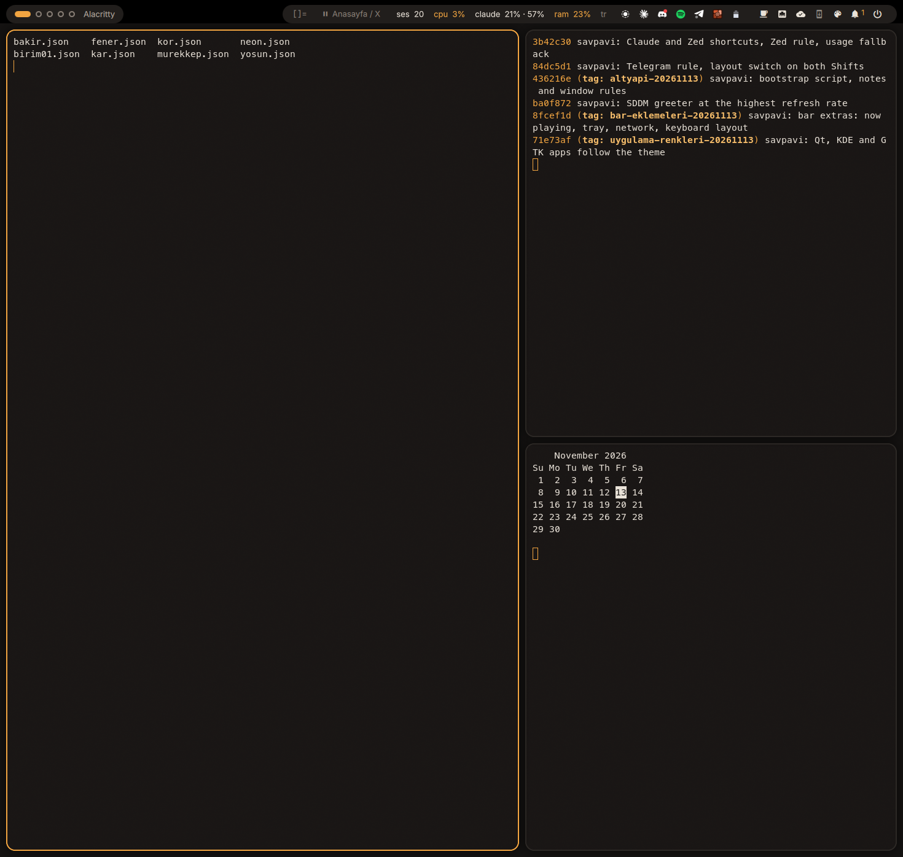

# dotfiles

My Arch Linux desktop: a patched [dwl](https://codeberg.org/dwl/dwl) (dwm for Wayland) with a Quickshell bar I wrote for it, twelve themes that change the whole desktop while it runs, a lock screen, a login screen, and a set of small desktop tools.

These are personal configs. Monitor names (`DP-1`, `DP-3`), paths and app choices fit my machine, so read before you copy.



More screenshots are in [`docs/screenshots/`](docs/screenshots).

## What is in here

| Path | What it holds |
|---|---|
| `dwl/` | The compositor: dwl v0.9 as a git subtree, with the ipc, monitorconfig, autostart, animation and scenefx patches and my own additions. `config.h` holds the keys and window rules |
| `bar/` | The Quickshell bar: three layouts (strip, islands, rail), tray, panels, notifications centre, lock screen, static wallpaper with a drawn-in transition (`WallFx.qml` + shader), and a small C client for dwl's IPC |
| `themes/` | One JSON file per theme: window manager, bar, terminal, menu, notifications, cursor, wallpapers |
| `bin/dwl-*` | Session wrapper, autostart, theme switcher, key sheet, screenshot, clipboard, download |
| `bin/dot-*` | Tools that do not depend on the session (Drive, send to phone, downloads, file-manager actions, OCR…) |
| `sddm/` | Login screen theme that follows the active theme |
| `portal/` | xdg-desktop-portal settings for screen sharing |
| `config/` | App configs symlinked into `~/.config` by `dot-link` (Alacritty, btop, fastfetch, Starship, environment.d) |
| `templates/` | Colour templates for Vesktop and Telegram, filled by `dwl-theme` |
| `wallpapers/omarchy/` | Backgrounds from Omarchy, used as static wallpapers |
| `extras/` | Pieces installed by hand: Dolphin service menus, systemd user units, `.desktop` launchers, MIME defaults, Firefox Nord theme |
| `install/` | `arch/install.sh` bootstraps a fresh Arch install; `dwl.sh` builds and installs the desktop |
| `tests/` | Unit tests for the tools and a headless test that applies every theme |
| `docs/dwl.md` | The details and the traps (in Turkish) |

## How it fits together

SDDM starts `bin/dwl-session`. It pins wlroots to the right GPU, sets the environment (including `DWL_HOME`, the root of this repo) and runs dwl. dwl starts `bin/dwl-autostart`, which launches the bar, the notification daemon, the polkit agent and the clipboard watcher. Nothing in the installed binary points at the repo: shortcuts and autostart go through `$DWL_HOME`.

`dwl-theme apply <id>` renders one theme JSON into `~/.local/state/dwl-theme/`. dwl watches `dwl.conf` there (colours, border, gaps, animation, corner radius, shadow, blur, cursor) and the bar watches `theme.json`, so both change without a restart. The same command recolours Alacritty, fuzzel, dunst, Qt/KDE/GTK apps, Obsidian, Vesktop, Spotify (spicetify), Telegram and the login screen.

## Install

```bash
git clone https://github.com/savpavi/dotfiles ~/dotfiles
~/dotfiles/install/dwl.sh --dry-run   # see what it would do
~/dotfiles/install/dwl.sh             # packages, build, install, login screen, user links, checks
```

On a fresh Arch install, `install/arch/install.sh` does the whole machine (packages, AUR, Flatpaks, config links, services) and runs `dwl.sh` as one of its stages.

After changing `dwl/dwl.c` or `dwl/config.h`: `install/dwl.sh derle kur`, then log out and in. The bar, the themes and the scripts need no install; the bar reloads when a file is saved.

## Themes

```bash
dwl-theme list            # themes, active one marked
dwl-theme apply kor       # apply one
dwl-theme pick            # choose in fuzzel (Super+Ctrl+Shift+Space)
dwl-theme wall next       # next wallpaper of the active theme
dwl-theme check           # validate the theme files
```

Mürekkep, Kor, Fener, Evangelion, Bakır, Kar, Neon, Yosun, Nord, Catppuccin, Rosé Pine, Monokrom. A new theme is a copy of one JSON with other colours. `live` lists Wallpaper Engine Workshop ids played through waywallen; static wallpapers per theme live outside the repo in `~/.config/dwl-theme/walls.json`.

## Tests

```bash
python3 -m unittest discover -s tests   # the dot-* tools
tests/themes.sh                         # every theme in a headless dwl session
```

`tests/themes.sh` validates the theme files, starts dwl without a screen and with a temporary state directory, applies each theme, switches the wallpaper, and fails if dwl or the bar dies or the bar logs a QML error. It does not touch the running session and it does not look at pixels.

## Desktop tools

| Command | Does |
|---|---|
| `dwl-grab` / `dot-grab` | Download the focused browser tab or the clipboard link: video sites via yt-dlp, galleries via gallery-dl, otherwise the direct file links on the page |
| `dwl-shot region\|edit\|screen` | Screenshot with grim/slurp, optionally edited in satty |
| `dwl-clip` | Clipboard history (cliphist) in fuzzel |
| `dwl-keys` | Key sheet generated from `dwl/config.h` (Super+K) |
| `dot-drive` | Google Drive through an rclone mount: status for the bar, share links, folder sync |
| `dot-send [FILE…]` | Send files to the paired phone over KDE Connect; LocalSend for other devices |
| `dot-wallfx <pick\|map\|warm\|install>` | Maps for the wallpaper transition: `sketch` draws the subject's outline with a pen and lets the rest bleed out, `spread` bleeds in from a few points. `install` sets up the cut-out (rembg in its own venv, about 900 MB) |
| `dot-fm` | Actions behind the Dolphin service menus: video and PDF tools, copy path, rename, duplicates |
| `dot-ocr` | Select a region, copy its text (tesseract) |
| `dot-webapp Name https://url` | Create a Brave Origin web-app launcher (never overwrites) |
| `dot-resolve [FILE…]` | Prepare a video for DaVinci Resolve |
| `dot-quicklook FILE` | Quick Look-style preview through GNOME Sushi |
| `dot-spin` | Spinning ASCII Arch logo next to fastfetch |
| `dot-link` | Symlink `config/*` into `~/.config`, backing up what is there |
| `dot-askpass` | Zenity askpass helper for `sudo -A` |

`dot-send` needs `kdeconnect` and `zenity`. `dot-drive` needs `rclone` with a remote named `gdrive:`; the units are in `extras/systemd/`. `dot-grab` needs `yt-dlp[default]` and `gallery-dl`, e.g. via `uv tool install`. `dot-wallfx` needs `python-numpy`, `python-pillow` and, for `install`, `uv`; rebuilding the shader needs `qsb` from `qt6-shadertools`.

## Updating dwl

The compositor source came in with its history through `git subtree`, so upstream changes merge into `dwl/`:

```bash
git subtree pull --prefix=dwl https://codeberg.org/dwl/dwl.git main
```

`docs/dwl.md` lists which third-party patches and which of my own additions touch the C source, and where conflicts are likely.

## History

Until November 2026 this repo held a Hyprland setup with a larger Quickshell shell (savpavi-shell), and before that Niri, Noctalia and DankMaterialShell layers. They are gone from the tree but remain in the git history. dwl lived in a separate repo until it was merged here.

## Licences and credits

- Everything outside `dwl/` that I wrote: MIT, see `LICENSE`.
- `dwl/`: GPL-3.0, with parts under the dwm, sway and tinywl licences (`dwl/LICENSE*`). The patches come from [dwl-patches](https://codeberg.org/dwl/dwl-patches).
- `templates/vesktop.css`: [DankMaterialShell](https://github.com/AvengeMedia/DankMaterialShell) matugen template, MIT © Avenge Media LLC (`templates/LICENSE-dms`).
- `templates/telegram.tdesktop-theme`: matugen-themes, MIT (`templates/LICENSE-matugen-themes`).
- `bar/scripts/claude-usage.sh`: claudeUsage DMS plugin, MIT © Bogdan Velicu.
- `wallpapers/omarchy/`: [basecamp/omarchy](https://github.com/basecamp/omarchy), MIT © David Heinemeier Hansson (`wallpapers/omarchy/UPSTREAM.md`).
- The wallpaper transition was inspired by pocket-dots; no code was taken from it.
